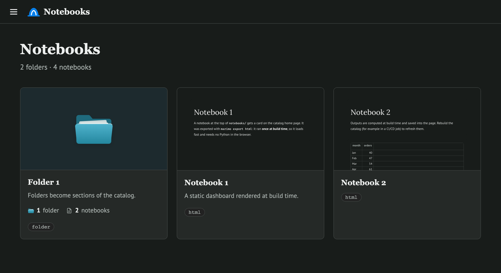

# Barnacles - a catalog for Marimo apps

<p align="center">
  
</p>

Barnacles generates a configuration-driven catalog of [marimo](https://marimo.io) apps that can be hosted as static HTML. You describe the catalog in a single `barnacles.yaml`, and Barnacles runs each notebook once at build time and writes plain HTML files that any static host can serve, with no server or backend to run.

The result is a set of static dashboards that load fast and are easy to host and keep up to date: build in Python (with AI coding agents if you like), then let a CI/CD job rebuild the catalog and publish it to GitHub Pages, Cloudflare Pages or any other static host.

Point it at a folder of notebooks. Folders become catalog sections, and each notebook gets a card with a light/dark thumbnail.

## Install

```sh
uv tool install barnacles      # or: pip install barnacles
```

That is all. The first build that needs card thumbnails downloads a headless Chromium (about 100 MB, see [Thumbnails](#thumbnails)).

## Usage

```sh
barnacles init                # creates a barnacles/ project with example notebooks
cd barnacles
barnacles serve               # build, then serve at http://127.0.0.1:8000
barnacles edit                # open the notebooks in the marimo editor
barnacles build               # build into dist/ for publishing
```

`barnacles init` creates a `barnacles` folder:

```
barnacles/
├── barnacles.yaml            # catalog settings
├── .gitignore                # keeps dist/ out of git
└── notebooks/                # the catalog home page
    ├── nb1.py
    ├── nb2.py
    └── folder1/              # a catalog section
        ├── nb3.py
        └── subfolder1/       # a nested section
            └── nb4.py
```

Pass a folder to create the project somewhere else (`barnacles init analytics`, or `barnacles init .` for the current folder). The other commands take an optional project path (a folder with `barnacles.yaml`, or the file itself). `build` and `serve` accept `--no-thumbnails` for faster builds. Run `barnacles <command> -h` for all options.

## Configuration

The catalog is described by one `barnacles.yaml` next to your notebooks folder. Every section and every key is optional: an empty file gives a working catalog of everything in `notebooks/`. All paths, including `exclude` patterns and the keys under `items`, are relative to `barnacles.yaml`.

A complete example:

```yaml
site:
  title: Energy dashboards
  header_title: Barnacles
  logo: assets/logo.svg
  favicon: assets/favicon.svg
  theme: dark

paths:
  notebooks: notebooks
  dist: dist

exclude:
  - "notebooks/drafts/**"
  - "notebooks/archive/**"
  - "**/_*.py"

defaults:
  notebook:
    mode: html
  folder:
    description: ""

items:
  "notebooks":
    title: All dashboards
  "notebooks/prices.py":
    title: Electricity prices
    description: Daily price analysis
    thumbnail: thumbnails/prices.png
  "notebooks/forecasts":
    title: Forecasts
```

The build stops with an error on unknown sections or keys, so typos don't go unnoticed.

### `site`

How the catalog looks in the browser.

| key | meaning | default |
|---|---|---|
| `title` | browser tab title | `Notebooks` |
| `header_title` | text next to the logo in the header | `title` |
| `logo` | image shown in the header | the barnacles logo |
| `favicon` | browser tab icon | `logo` |
| `theme` | default theme: `dark`, `system` (follow the operating system) or `light` | `dark` |

Visitors can switch between dark, system and light with the switch at the bottom of the navigation menu, and their choice is remembered in their browser. The theme applies to the whole catalog: the header, the navigation menu, the card thumbnails (each notebook is screenshotted in both themes) and the marimo apps themselves.

### `paths`

Where barnacles reads notebooks from and writes the site to.

| key | meaning | default |
|---|---|---|
| `notebooks` | folder holding the notebooks; it becomes the catalog home page | `notebooks` |
| `dist` | output folder to publish; **wiped on every build** | `dist` |

barnacles refuses a `dist` that would overlap your sources (the project folder itself, a parent of it, or a folder containing the notebooks).

### `exclude`

A list of path patterns for notebooks and folders to leave out of the catalog. Excluded notebooks are not exported or screenshotted.

```yaml
exclude:
  - "notebooks/drafts/**"     # everything under notebooks/drafts/
  - "notebooks/archive"       # the folder itself, same effect
  - "**/_*.py"                # any notebook starting with _, in any folder
```

- `*` matches within one folder, `?` matches one character, and `**` matches across folders (`**/` also matches no folder, so `**/_*.py` covers `notebooks/_x.py`).
- Patterns are matched against the whole path relative to `barnacles.yaml`, so start them with `notebooks/` (or your `paths.notebooks`) or with `**/`.
- A folder left with no notebooks disappears from the catalog.

Some folders are always skipped without being listed: those whose names start with `.` or `_` (such as marimo's `__marimo__`), and folders with no notebooks at any depth.

### `defaults`

Settings applied to every notebook (`defaults.notebook`) or every folder (`defaults.folder`). They take the same keys as `items` below. A typical use is switching the export mode for the whole catalog.

### `items`

Overrides for single notebooks or folders, keyed by path. A notebook appears in the catalog without an entry here: you only add one to change something. The key `notebooks` (your `paths.notebooks`) is the home page.

Settings are resolved in this order: `items`, then `defaults`, then the built-in defaults below.

| key | applies to | meaning | default |
|---|---|---|---|
| `title` | both | display name | notebook: `marimo.App(app_title=...)`, then the slug; folder: its name; home page: `Notebooks` |
| `description` | both | text on the card and on the folder page | none |
| `mode` | notebook | `html` runs the notebook once at build time and exports static HTML; `html-wasm` exports a WebAssembly page that runs Python in the browser, for notebooks that need live controls | `html` |
| `slug` | notebook | URL segment | the file name, with `_` turned into `-` |
| `thumbnail`, `thumbnail_dark` | notebook | card images for the light and dark themes | a screenshot of the notebook; the light image is used for both if no dark one is given |

The build stops on an `items` key that matches no notebook or folder, including one that is excluded.

### Output

`dist/` is a plain static site. All links in it are relative, so it works at a domain root or under a subpath, on GitHub Pages, Cloudflare Pages or any other static host.

## Thumbnails

Each notebook card shows a light and a dark screenshot of the notebook, taken with [Playwright](https://playwright.dev/python/)'s headless Chromium. Playwright comes with barnacles, but uv (or pip) can't download the browser itself, so barnacles does it:

- **Automatically:** when a build needs screenshots and Chromium is missing, barnacles runs `python -m playwright install --only-shell chromium` with its own Python, printing the command first. This happens once per Playwright version. The browser goes into Playwright's shared cache (`~/Library/Caches/ms-playwright` on macOS, `~/.cache/ms-playwright` on Linux, `%LOCALAPPDATA%\ms-playwright` on Windows; set `PLAYWRIGHT_BROWSERS_PATH` to change it).
- **Explicitly:** `barnacles install-browser` does the same step on its own, e.g. as a separate CI step. On a fresh Linux machine, `barnacles install-browser --with-deps` also installs Chromium's system libraries (via `apt`, so it needs sudo and Debian/Ubuntu).

If the browser can't be installed or started (offline, missing Linux libraries), the build still succeeds: it prints a warning saying how to fix it, and the cards show a letter instead. Use `--no-thumbnails` to skip screenshots, or set `thumbnail` in `barnacles.yaml` to use your own images.

### In CI

On GitHub Actions, the plain install works:

```yaml
- uses: astral-sh/setup-uv@v6
- run: uv tool install barnacles    # or: pip install barnacles
- run: barnacles build              # downloads Chromium on the first run
```

To keep the download in its own step and cache it between runs:

```yaml
- uses: astral-sh/setup-uv@v6
- run: uv tool install barnacles    # or: pip install barnacles
- uses: actions/cache@v4
  with:
    path: ~/.cache/ms-playwright
    key: ms-playwright-${{ runner.os }}-${{ hashFiles('**/requirements*.txt', '**/uv.lock') }}
- run: barnacles install-browser    # add --with-deps on minimal Linux images
- run: barnacles build
```

## Development

```sh
uv sync                                  # installs barnacles in editable mode + dev tools
uv run barnacles serve demo              # the demo gallery in demo/
uv run pytest
```

Releases: bump `__version__` in `src/barnacles/__init__.py`, push, then publish a GitHub release tagged `v<version>` (e.g. `v0.2.0`). `.github/workflows/publish.yml` checks the tag matches, runs the tests, builds the package and uploads it to PyPI.

## License

MIT, see [LICENSE](LICENSE).
